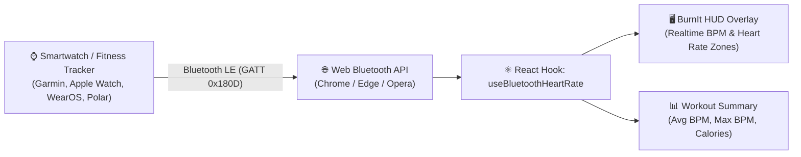

# ⌚ Bluetooth Smartwatch & Heart Rate Integration Guide for BurnIt

This step-by-step guide explains how to connect a Bluetooth-enabled smartwatch or heart rate monitor directly to **BurnIt** using the native **Web Bluetooth API** (`navigator.bluetooth`).

---

## 📋 Overview & Architecture

Modern smartwatches and fitness monitors use **Bluetooth Low Energy (BLE)** with the standardized Bluetooth SIG **Heart Rate Service (`0x180D`)**. 

Because this is a global standard, **BurnIt runs 100% inside the browser**—no native desktop apps, no backend bridges, and no custom drivers required!



---

## 🚦 Browser & System Prerequisites

| Requirement | Supported | Notes |
|---|---|---|
| **Google Chrome** | ✅ Yes | Recommended (Desktop & Android) |
| **Microsoft Edge** | ✅ Yes | Recommended (Desktop & Android) |
| **Opera** | ✅ Yes | Chromium-based |
| **Safari (Mac/iOS)** | ❌ No | Apple restricts Web Bluetooth in Safari |
| **Firefox** | ❌ No | Mozilla has not implemented Web Bluetooth |
| **Connection Security** | 🔒 Required | Must run on `https://` or `http://localhost` |

> [!NOTE]
> Make sure **Bluetooth is turned ON** on your computer or phone before attempting to pair.

---

## 🏁 Phase 1: Smartwatch Device Setup (Enable Broadcasting)

Before clicking "Connect" on your computer, your smartwatch must be set to broadcast its heart rate over Bluetooth:

### 1. Garmin Watches (Forerunner, Fenix, Venu, Vivoactive)
1. Hold the **Menu/Up** button on your watch.
2. Go to **Sensors & Accessories** → **Wrist Heart Rate**.
3. Select **Broadcast Heart Rate** (or **Broadcast During Activity**).
4. Select **Start**. Your watch will now show "Broadcasting...".

### 2. Apple Watch (Series 3 through Ultra)
Apple Watch does not broadcast standard BLE HR by default. Install one of these free companion apps on your watch:
1. Download **HeartCast** or **Echo Heart Rate** from the Apple Watch App Store.
2. Open the app on your Apple Watch and tap **Start Broadcast**.

### 3. Wear OS / Samsung Galaxy Watch (Watch 4, 5, 6, 7)
1. Install **Heart Rate Broadcaster** or **BLE Heart Rate** from the Google Play Store on your watch.
2. Open the app and toggle **Start Broadcasting**.

### 4. Dedicated Fitness Bands & Chest Straps (Polar, Whoop, Wahoo, Xiaomi)
* **Polar H10 / Verity Sense, Wahoo TICKR, Whoop 4.0, Scosche**: Turn on or put on the strap; they broadcast standard BLE HR automatically.
* **Xiaomi / Amazfit Band**: In the Zepp Life / Mi Fitness app, enable **Heart rate sharing / Discoverable**.

---

## 🛠️ Phase 2: Create the React Bluetooth Hook

Create a reusable React hook: `frontend/src/hooks/useBluetoothHeartRate.js`

```javascript
import { useState, useCallback, useRef, useEffect } from 'react';

// Standard Bluetooth SIG UUIDs
const HEART_RATE_SERVICE_UUID = 'heart_rate'; // 0x180D
const HEART_RATE_MEASUREMENT_UUID = 'heart_rate_measurement'; // 0x2A37

export const useBluetoothHeartRate = () => {
  const [bpm, setBpm] = useState(null);
  const [device, setDevice] = useState(null);
  const [isConnected, setIsConnected] = useState(false);
  const [isSupported, setIsSupported] = useState(false);
  const [error, setError] = useState(null);
  const [history, setHistory] = useState([]); // Array of { bpm, timestamp }

  const serverRef = useRef(null);

  // Check Web Bluetooth support on mount
  useEffect(() => {
    setIsSupported(typeof navigator !== 'undefined' && 'bluetooth' in navigator);
  }, []);

  // Parse standard Bluetooth GATT Heart Rate Data Packet
  const handleCharacteristicValueChanged = (event) => {
    const value = event.target.value;
    const flags = value.getUint8(0);

    // Flag bit 0: 0 = 8-bit Heart Rate, 1 = 16-bit Heart Rate
    const rate16Bits = flags & 0x1;
    let heartRate = 0;
    if (rate16Bits) {
      heartRate = value.getUint16(1, /* littleEndian = */ true);
    } else {
      heartRate = value.getUint8(1);
    }

    if (heartRate > 30 && heartRate < 250) {
      setBpm(heartRate);
      setHistory((prev) => [
        ...prev.slice(-180), // Keep last 180 readings (~3 minutes)
        { bpm: heartRate, time: Date.now() },
      ]);
    }
  };

  // Connect to Smartwatch
  const connect = useCallback(async () => {
    setError(null);
    try {
      if (!navigator.bluetooth) {
        throw new Error('Web Bluetooth is not supported in this browser. Use Chrome or Edge.');
      }

      // Request pairing with any BLE device advertising Heart Rate Service
      const selectedDevice = await navigator.bluetooth.requestDevice({
        filters: [{ services: [HEART_RATE_SERVICE_UUID] }],
        optionalServices: ['battery_service'],
      });

      selectedDevice.addEventListener('gattserverdisconnected', () => {
        setIsConnected(false);
        setBpm(null);
      });

      const server = await selectedDevice.gatt.connect();
      serverRef.current = server;

      const service = await server.getPrimaryService(HEART_RATE_SERVICE_UUID);
      const characteristic = await service.getCharacteristic(HEART_RATE_MEASUREMENT_UUID);

      // Start receiving live notifications
      await characteristic.startNotifications();
      characteristic.addEventListener('characteristicvaluechanged', handleCharacteristicValueChanged);

      setDevice(selectedDevice);
      setIsConnected(true);
    } catch (err) {
      console.error('Bluetooth connection error:', err);
      if (err.name !== 'NotFoundError') { // Don't show error if user simply canceled picker
        setError(err.message || 'Failed to connect to smartwatch.');
      }
    }
  }, []);

  // Disconnect cleanly
  const disconnect = useCallback(() => {
    if (serverRef.current && serverRef.current.connected) {
      serverRef.current.disconnect();
    }
    setDevice(null);
    setIsConnected(false);
    setBpm(null);
  }, []);

  // Calculate workout metrics
  const avgBpm = history.length > 0 
    ? Math.round(history.reduce((acc, h) => acc + h.bpm, 0) / history.length) 
    : null;
    
  const maxBpm = history.length > 0 
    ? Math.max(...history.map((h) => h.bpm)) 
    : null;

  return {
    bpm,
    avgBpm,
    maxBpm,
    deviceName: device?.name || 'Smartwatch',
    isConnected,
    isSupported,
    error,
    connect,
    disconnect,
  };
};
```

---

## 🎨 Phase 3: Connect UI in `RealtimeTracker.jsx`

### 1. Import and Call Hook
In `frontend/src/pages/tracker/RealtimeTracker.jsx`:

```javascript
import { useBluetoothHeartRate } from '../../hooks/useBluetoothHeartRate';

export const RealtimeTracker = () => {
  // Call the smartwatch hook
  const {
    bpm,
    avgBpm,
    maxBpm,
    deviceName,
    isConnected: isWatchConnected,
    isSupported: isWatchSupported,
    connect: connectWatch,
    disconnect: disconnectWatch,
  } = useBluetoothHeartRate();
  
  // ... rest of tracker logic
```

### 2. Add Smartwatch Connect Button in Video Controls
Add a Bluetooth pairing button in the video overlay top-right corner:

```jsx
{/* Smartwatch Connect Pill */}
{isWatchSupported && (
  <button
    onClick={isWatchConnected ? disconnectWatch : connectWatch}
    className={`px-3 py-1 rounded-full text-xs font-semibold backdrop-blur-md border transition-all flex items-center gap-1.5 ${
      isWatchConnected
        ? 'bg-rose-600/90 border-rose-500 text-white shadow-sm'
        : 'bg-black/60 border-white/10 text-neutral-300 hover:text-white'
    }`}
    title={isWatchConnected ? `Connected to ${deviceName}` : 'Connect Bluetooth Smartwatch'}
  >
    <span className={`w-2 h-2 rounded-full ${isWatchConnected ? 'bg-white animate-ping' : 'bg-rose-500'}`} />
    {isWatchConnected ? `${bpm || '--'} BPM` : '⌚ Connect Watch'}
  </button>
)}
```

### 3. Add Live Heart Rate Zone Card in Sidebar
Add this card in the sidebar (`lg:col-span-3`):

```jsx
{/* Heart Rate & Cardio Intensity Card */}
{isWatchConnected && (
  <div className="p-3.5 rounded-xl bg-rose-500/10 border border-rose-500/20 text-xs">
    <div className="flex items-center justify-between mb-1.5">
      <div className="flex items-center gap-1.5">
        <span className="w-2.5 h-2.5 rounded-full bg-rose-500 animate-pulse" />
        <span className="font-bold text-rose-500 uppercase tracking-wider text-[11px]">Heart Rate</span>
      </div>
      <span className="text-[10px] text-neutral-400 font-mono">{deviceName}</span>
    </div>
    
    <div className="flex items-baseline gap-2">
      <span className="text-3xl font-extrabold text-rose-600 dark:text-rose-400 font-mono">
        {bpm || '--'}
      </span>
      <span className="text-xs text-neutral-400 font-medium">BPM</span>
      <span className="ml-auto text-[10px] px-2 py-0.5 rounded-full font-bold uppercase bg-rose-500/20 text-rose-400">
        {bpm >= 155 ? 'Peak Zone' : bpm >= 135 ? 'Cardio Zone' : bpm >= 115 ? 'Fat Burn' : 'Warm-up'}
      </span>
    </div>
  </div>
)}
```

---

## 📺 Phase 4: Display BPM on Camera HUD (`skeletonRenderer.js`)

In `frontend/src/lib/skeletonRenderer.js`:

Pass `bpm` into `drawWorkoutHUD(ctx, width, height, data)`:

```javascript
// Render Heart Rate Badge in Top-Right corner next to Form Precision
if (bpm && bpm > 0) {
  const hrX = width - 210;
  const hrY = 20;

  ctx.fillStyle = 'rgba(14, 14, 20, 0.85)';
  ctx.strokeStyle = 'rgba(244, 63, 94, 0.3)';
  ctx.lineWidth = 1;
  ctx.beginPath();
  ctx.roundRect(hrX, hrY, 90, 44, 14);
  ctx.fill();
  ctx.stroke();

  // Heart Icon / Label
  ctx.fillStyle = '#f43f5e';
  ctx.font = 'bold 10px Inter, system-ui, sans-serif';
  ctx.fillText('♥ HEART RATE', hrX + 10, hrY + 16);

  // BPM Value
  ctx.fillStyle = '#ffffff';
  ctx.font = 'bold 18px Inter, system-ui, sans-serif';
  ctx.fillText(`${bpm} BPM`, hrX + 10, hrY + 36);
}
```

---

## 📊 Phase 5: Workout Summary Integration

When the user finishes their workout, save heart rate metrics in the workout summary:

In `handleFinishWorkout`:
```javascript
setSummaryData({
  exercise: telemetry.detectedInfo?.name || activeExercise,
  reps: telemetry.reps,
  duration: workoutDuration,
  avgFormScore: telemetry.formScore,
  calories: cals,
  avgBpm: avgBpm || null,
  maxBpm: maxBpm || null,
  // ... rest of summary
});
```

In the **Workout Complete** modal:
```jsx
{summaryData.avgBpm && (
  <div className="p-4 rounded-xl bg-neutral-100 dark:bg-white/5">
    <span className="text-[10px] font-bold uppercase text-neutral-400 block mb-1">
      Avg Heart Rate
    </span>
    <span className="text-lg font-bold font-mono text-rose-500">
      {summaryData.avgBpm} BPM (Max: {summaryData.maxBpm})
    </span>
  </div>
)}
```

---

## 🧪 Phase 6: Testing & Troubleshooting

### How to test WITHOUT a physical smartwatch:
1. Open Chrome on your computer.
2. Install the free Chrome extension: **"Bluetooth LE Web Simulator"** or use an Android phone with the app **"BLE Peripheral Simulator"** (select Heart Rate Service).
3. Tap **Connect Watch** in BurnIt and select the virtual device.
4. Verify that the BPM updates in real-time on your screen!

### Common Issues & Quick Fixes:
* **"No compatible devices found" in Chrome pop-up**:
  * Make sure your smartwatch is actively showing "Broadcasting Heart Rate".
  * Ensure the watch is not currently connected to another app (like Strava or Apple Fitness).
* **"User cancelled the requestDevice() chooser"**:
  * The user closed the browser dialog without choosing a device. Safe to ignore.
* **Connection drops mid-workout**:
  * The `gattserverdisconnected` event in the hook automatically updates the UI to show disconnected, allowing one-click reconnection.

---

## 🎯 Summary Checklist

- [ ] Create `frontend/src/hooks/useBluetoothHeartRate.js`
- [ ] Connect hook in `RealtimeTracker.jsx`
- [ ] Add `Connect Watch` button in top video controls
- [ ] Add BPM display to camera canvas HUD (`skeletonRenderer.js`)
- [ ] Include Avg BPM and Max BPM in Workout Summary Modal

