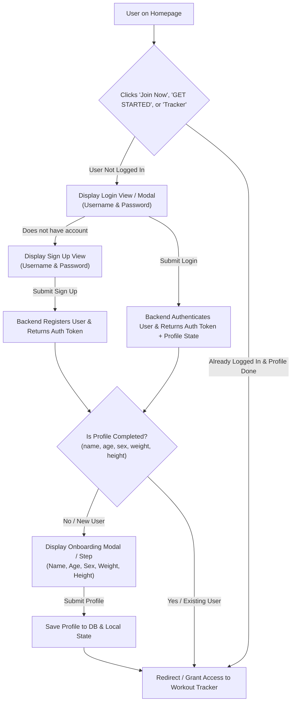

# BurnIt: Authentication, Onboarding, and Tracker Protection Plan

> [!NOTE]
> **Status: Implemented & Active**  
> All requirements from this plan have been implemented across the backend (`database.py`, `models.py`, `auth.py`, `routes/auth.py`) and frontend (`AuthContext.jsx`, `AuthModal.jsx`, `OnboardingModal.jsx`, `ProtectedRoute.jsx`, `UserMenu.jsx`, `Navbar.jsx`, `homepage.jsx`, `App.jsx`).

This document details the complete technical architecture, user flow, API specifications, and step-by-step implementation plan for BurnIt's user authentication, sign-up, new-user onboarding (profile setup), and route protection for the workout tracker.

---

## 1. Flow Diagram & User Journey



---

## 2. Requirement Breakdown & Scope

### A. Login Experience
- **Triggers**:
  - Clicking **"Join Now"** (Navbar, Mobile Menu, Homepage CTA).
  - Clicking **"GET STARTED"** (Hero section).
  - Clicking **"Tracker"** or **"Workout Tracker"** when not logged in.
- **Fields**:
  - `Username`
  - `Password`
- **Actions**:
  - "Log In" button.
  - "Don't have an account? **Sign Up**" toggle link.
  - Error banner on invalid credentials.

### B. Sign Up Experience
- **View**: Accessible directly from the Login prompt if the user does not have an account.
- **Fields**:
  - `Username` (unique, minimum length check)
  - `Password` (minimum length check)
  - `Confirm Password` (client-side validation)
- **Actions**:
  - "Create Account" button.
  - "Already have an account? **Log In**" toggle link.
  - Auto-logs in upon successful registration.

### C. New User Onboarding (Biometric Profile Setup)
- **Condition**: Triggers immediately after authentication if the user is new (profile fields are empty / `is_profile_completed == false`).
- **Required Fields**:
  1. **Full Name / Display Name** (`text`)
  2. **Age** (`number`, e.g., 18–100)
  3. **Sex** (`select`: Male / Female / Other)
  4. **Weight** (`number`, in kg, e.g., 65.5)
  5. **Height** (`number`, in cm, e.g., 175)
- **Significance**:
  - Directly fulfills the biometric parameters required by the **BurnIt Calorie Prediction Model** (Keytel formula and Random Forest Regressor outlined in `plan.md`).
  - Saved to the user record in SQLite and cached in `localStorage` for offline / instant session access.

### D. Protected Tracker Route (`/tracker`)
- **Access Rule**: The `/tracker` route is strictly protected.
- **Behavior**:
  - If an unauthenticated user navigates to `/tracker` or clicks any tracker button, access is blocked.
  - The login view/modal is presented with a redirect return target (`redirect=/tracker`).
  - Once logged in (and onboarding completed), the user is automatically navigated directly into the Workout Tracker.

---

## 3. Backend Architecture & Database Changes

### A. SQLite Schema Update (`backend/database.py`)
Extend the `users` table to persist profile biometrics and onboarding status:

```sql
CREATE TABLE IF NOT EXISTS users (
    id TEXT PRIMARY KEY,
    username TEXT UNIQUE NOT NULL,
    password_hash TEXT NOT NULL,
    is_admin INTEGER DEFAULT 0,
    name TEXT DEFAULT NULL,
    age INTEGER DEFAULT NULL,
    sex TEXT DEFAULT NULL,
    weight REAL DEFAULT NULL,
    height REAL DEFAULT NULL,
    is_profile_completed INTEGER DEFAULT 0,
    created_at TIMESTAMP DEFAULT CURRENT_TIMESTAMP
);
```

> **Migration**: If `burnit.db` already exists with the old schema, `init_db()` will automatically execute `ALTER TABLE users ADD COLUMN ...` safely to preserve any existing test data.

### B. Pydantic Models (`backend/models.py`)
```python
class UserRegister(BaseModel):
    username: str
    password: str

class UserProfileUpdate(BaseModel):
    name: str
    age: int
    sex: str
    weight: float
    height: float

class UserResponse(BaseModel):
    id: str
    username: str
    name: Optional[str] = None
    age: Optional[int] = None
    sex: Optional[str] = None
    weight: Optional[float] = None
    height: Optional[float] = None
    is_profile_completed: bool = False
    is_admin: bool = False

class TokenResponse(BaseModel):
    access_token: str
    token_type: str = "bearer"
    user: UserResponse
```

### C. Authentication Endpoints (`backend/routes/auth.py`)
1. **`POST /api/auth/register`**:
   - Make publicly accessible (remove the current `_ = Depends(require_admin)` barrier).
   - Hashes password using PBKDF2.
   - Creates user record with `is_profile_completed = 0`.
   - Returns JWT access token and user info.
2. **`POST /api/auth/login`**:
   - Validates credentials against DB (or admin shortcut).
   - Returns JWT access token, username, and `is_profile_completed`.
3. **`GET /api/auth/me`**:
   - Requires Bearer token.
   - Returns complete user profile and completion flag.
4. **`PUT /api/auth/profile`**:
   - Requires Bearer token.
   - Updates `name`, `age`, `sex`, `weight`, `height`, sets `is_profile_completed = 1`.

---

## 4. Frontend Architecture & Component Structure

### A. New Context & Utilities
1. **`frontend/src/context/AuthContext.jsx`**:
   - Manages `token`, `user`, `isAuthenticated`, `isLoading`.
   - Provides methods: `login(username, password)`, `register(username, password)`, `updateProfile(data)`, `logout()`.
   - Persists JWT and user profile in `localStorage`.
2. **`frontend/src/components/ProtectedRoute.jsx`**:
   - Wraps protected routes (e.g., `<Route path="/tracker" element={<ProtectedRoute><RealtimeTracker /></ProtectedRoute>} />`).
   - If not authenticated, opens the Auth Modal or redirects to `/login` preserving the intended destination.

### B. New UI Components
1. **`frontend/src/components/auth/AuthModal.jsx`**:
   - Unified modal dialog with animated switching between:
     - **Login Tab**: Username and Password fields.
     - **Sign Up Tab**: Username, Password, Confirm Password fields.
   - Matches BurnIt's theme (dark mode `#13131a` / light mode, orange accent buttons).
2. **`frontend/src/components/auth/OnboardingModal.jsx`**:
   - Non-dismissable step for new users right after login/registration.
   - Clean card prompting for:
     - **Name** (input)
     - **Age** (number input)
     - **Sex** (segmented buttons: Male / Female / Other)
     - **Weight in kg** (number input)
     - **Height in cm** (number input)
   - "Save & Start Training" submit button.
3. **User Profile Badge in Navbar**:
   - Shows logged-in user's name/initials in Navbar instead of "Join Now".
   - Dropdown with "Log Out" and "Edit Profile".

---

## 5. Step-by-Step Implementation Plan

| Step | Scope | Details |
| :--- | :--- | :--- |
| **1. DB Migration & Schema** | Backend | Update `database.py` with columns: `name`, `age`, `sex`, `weight`, `height`, `is_profile_completed`. Include migration check. |
| **2. Auth Routes & Models** | Backend | Open `/register` to public; create `/profile` PUT and `/me` GET endpoints; return `is_profile_completed` on login. |
| **3. AuthContext** | Frontend | Create `AuthContext.jsx` with token management, user state, and API integration. Wrap in `App.jsx`. |
| **4. Auth Modal & Flow** | Frontend | Implement `AuthModal.jsx` with Login and Sign-up tabs, error handling, and clean dark/light UI. |
| **5. Onboarding Modal** | Frontend | Implement `OnboardingModal.jsx` collecting Name, Age, Sex, Weight, Height when `user.is_profile_completed === false`. |
| **6. Protected Route** | Frontend | Wrap `/tracker` in `ProtectedRoute`. Unauthenticated attempts prompt the login modal or redirect. |
| **7. Navbar & CTA Wiring** | Frontend | Update "Join Now" and "GET STARTED" buttons to trigger the Auth Modal (or go straight to tracker if already logged in). Replace "Join Now" with user profile badge when logged in. |
| **8. Calorie Predictor Sync** | Integration | Ensure saved weight, age, sex, and height automatically feed the calorie prediction modal from `plan.md`. |

---

## 6. Review & Clarification Check

Please review these design choices and let me know if you would like any changes:

1. **Modal vs Dedicated Page**:
   - *Current Plan*: A sleek, popup Modal (like Netflix/Nike) that opens over whatever page the user is on when they click "Join Now" or "Get Started", with fallback to a standalone `/login` page if directly visited.
   - *Alternative*: Standard separate pages (`/login` and `/signup`).
2. **Onboarding Fields**:
   - The fields requested are: **Name, Age, Sex, Weight (kg), Height (cm)**. Are there any additional fields needed (e.g. fitness goal, activity level), or are these 5 exact?
3. **Sign-up Credentials**:
   - *Current Plan*: Username and Password only (no email required). If you want Email included as well, please specify.
4. **Tracker Behavior**:
   - If a guest clicks "Workout Tracker" on the top bar or navigates to `/tracker`, the system displays the Login prompt and redirects them into the workout room immediately once authenticated and onboarded.

