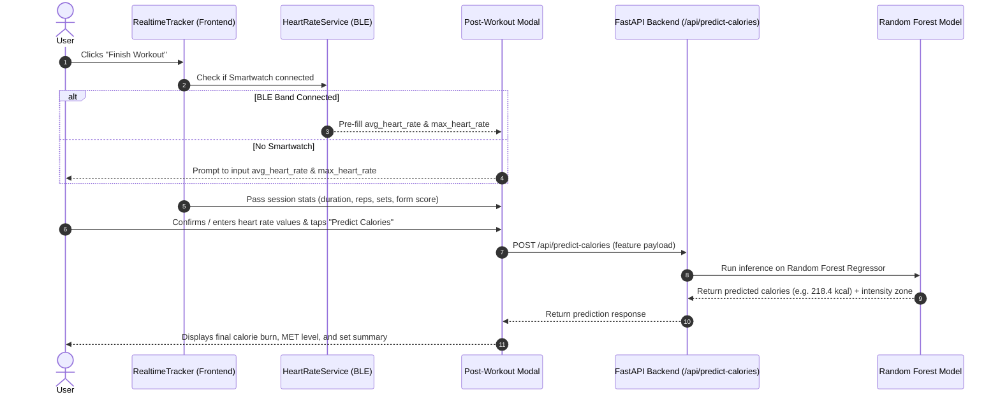

# BurnIt: Post-Workout Calorie Burn Prediction Plan

---

## 1. Executive Summary

This plan outlines the architecture, dataset structure, and machine learning pipeline for predicting **calories burned across all exercises** upon finishing a workout session in **BurnIt**.

When the user clicks **"Finish Workout"**:
1. BurnIt captures real-time session telemetry (**duration**, **exercise type**, **reps**, **sets**, **form score**).
2. The user is prompted to input missing values: **Average Heart Rate (BPM)** and **Maximum Heart Rate (BPM)** (auto-prefilled if a Bluetooth smartwatch is connected, or manually typed).
3. Two machine learning algorithms (**Linear Regression** and **Random Forest Regressor**) are trained and compared for accuracy ($R^2$, MAE, RMSE).
4. The winning algorithm (**Random Forest Regressor**) is deployed as the single production model to predict calories burned accurately.

---

## 2. Dataset Location & Folder Structure

A dedicated dataset directory has been created in the project:

```
c:\BurnIt\
├── datasets\                       <-- [PRIMARY] Put your CSV dataset files here
│   ├── README.md                   <-- Column reference guide
│   ├── calorie_dataset_template.csv <-- Template CSV with sample records
│   └── your_dataset.csv            <-- (Your custom dataset file)
├── backend\
│   ├── datasets\                   <-- Mirrored folder for backend access
│   ├── models\                     <-- Where trained model (.joblib) is saved
│   ├── train_calorie_model.py      <-- Model training & comparison script
│   └── routes\
│       └── calories.py             <-- FastAPI prediction endpoint
└── frontend\
    └── src\pages\tracker\
        └── RealtimeTracker.jsx     <-- Post-workout input modal & prediction UI
```

> [!TIP]
> You can drag and drop your CSV dataset directly into `c:\BurnIt\datasets\` or `c:\BurnIt\backend\datasets\`.

---

## 3. Data Needed to Predict Calories Burned

To predict caloric expenditure with high physiological accuracy, the dataset requires **11 input features** and **1 target column**:

### Summary Table

| Category | Column Name | Type | Unit / Format | Description & Why It Is Needed |
| :--- | :--- | :--- | :--- | :--- |
| **Target Variable** | `calories_burned` | `float` | kcal | **Ground truth target ($y$)**: Total calories burned during the workout session. |
| **Cardiovascular** | `avg_heart_rate` | `float` | BPM | **User Input**: Average heart rate during exercise. Directly reflects oxygen consumption ($\text{VO}_2$) and cardiovascular exertion. |
| **Cardiovascular** | `max_heart_rate` | `float` | BPM | **User Input**: Peak heart rate reached during session. Identifies anaerobic threshold bursts and maximum effort peaks. |
| **Demographics** | `gender` | `string` / `int` | `male` / `female` (or `1` / `0`) | Biological sex strongly affects Basal Metabolic Rate (BMR) and lean muscle mass ratio. |
| **Demographics** | `age` | `int` | years | Determines age-predicted maximum heart rate ($220 - \text{age}$) and metabolic rate. |
| **Demographics** | `weight_kg` | `float` | kg | **Crucial mechanical multiplier**: Lifting or moving a 90kg body against gravity burns significantly more calories than moving a 55kg body. |
| **Demographics** | `height_cm` | `float` | cm | Stature measurement used with weight for Body Mass Index (BMI) and body surface area calculations. |
| **Session Work** | `duration_min` | `float` | minutes | Active workout time. Primary cumulative duration multiplier for energy expenditure. |
| **Session Work** | `exercise_type` | `string` | Categorical | Specific exercise (`squat`, `pushup`, `bicepcurl`, `plank`, `jumpingjack`, or `mixed`). Each exercise has a distinct Metabolic Equivalent (MET). |
| **Session Work** | `total_reps` | `int` | count | Total repetitions completed across all sets. Quantifies mechanical volume. |
| **Session Work** | `total_sets` | `int` | count | Total number of sets completed. |
| **Biomechanical** | `avg_form_score` | `float` | percentage (`0-100%`) | Average form accuracy from MediaPipe tracking. Full range of motion burns more energy than shallow, incorrect form. |

### Sample Dataset Row
```csv
gender,age,height_cm,weight_kg,duration_min,avg_heart_rate,max_heart_rate,exercise_type,total_reps,total_sets,avg_form_score,calories_burned
male,25,175.0,72.5,20.0,142.0,168.0,squat,60,4,92.0,185.4
female,28,162.0,58.0,15.0,135.0,155.0,bicepcurl,45,3,88.5,88.2
male,32,180.0,85.0,25.0,156.0,178.0,jumpingjack,120,5,95.0,245.0
```

---

## 4. Post-Workout User Experience & Missing Inputs Flow



1. **Automatic Data Captured by BurnIt**:
   - Total workout duration (`duration_min`)
   - Exercises performed (`exercise_type`)
   - Completed reps (`total_reps`) and completed sets (`total_sets`)
   - Average form score (`avg_form_score`)
2. **Missing Values Prompted to User**:
   - **Average Heart Rate (BPM)**: Text input field (e.g., `138` BPM) — pre-filled automatically if a smartwatch is connected.
   - **Maximum Heart Rate (BPM)**: Text input field (e.g., `165` BPM) — pre-filled automatically if a smartwatch is connected.
   - **Body Weight (kg)** & **Age**: Pre-filled from user profile or prompted on first use.

---

## 5. Machine Learning Models: Linear Regression vs. Random Forest

To evaluate accuracy and select the optimal model, we train and benchmark **Linear Regression** and **Random Forest Regressor** side-by-side using the same train/test split.

```
+---------------------------------------------------------------------------------+
|                                Model Comparison                                 |
+---------------------------------------+-----------------------------------------+
| Linear Regression                     | Random Forest Regressor                 |
| - Fast, linear baseline               | - Non-linear ensemble of decision trees |
| - Assumes constant rate of burn       | - Captures anaerobic thresholds         |
| - Cannot model complex interactions   | - Automatically handles feature pairs   |
| - Baseline accuracy                   | - Superior predictive accuracy          |
+---------------------------------------+-----------------------------------------+
```

### Model 1: Multiple Linear Regression (Baseline)
- **Mathematical Form**:
  $$\hat{y} = \beta_0 + \beta_1(\text{duration}) + \beta_2(\text{avg\_hr}) + \beta_3(\text{max\_hr}) + \beta_4(\text{weight}) + \dots + \epsilon$$
- **Strengths**: Lightweight, instantaneous execution, clear interpretable coefficients.
- **Weaknesses**:
  - Human metabolism is **non-linear**: moving from 130 to 160 BPM burns energy at an exponentially higher rate than moving from 70 to 100 BPM.
  - Cannot naturally capture interactions (e.g., high body weight with jumping jacks burns far more energy than high body weight with bicep curls).

### Model 2: Random Forest Regressor (Ensemble of Trees)
- **Mathematical Form**:
  $$\hat{y} = \frac{1}{B} \sum_{b=1}^{B} T_b(\mathbf{x})$$
  Combines 100+ independent decision trees trained via bootstrap aggregating (bagging) with randomized feature subsets.
- **Strengths**:
  - Naturally handles non-linear cardiovascular thresholds and metabolic shifts.
  - Automatically captures complex interactions between exercise type, body weight, reps, and heart rate.
  - Robust against outliers and multicollinearity between average and maximum heart rate.
  - Provides feature importance rankings.

### Model Evaluation Metrics
Both models will be trained on 80% of the dataset and tested on the remaining 20% using:
1. **$R^2$ Score (Coefficient of Determination)**: Proportion of variance explained (higher is better, target $> 0.95$).
2. **Mean Absolute Error (MAE)**: Average difference in kcal between predicted and actual burn (lower is better, target $< 5.0\text{ kcal}$).
3. **Root Mean Squared Error (RMSE)**: Penalizes large error outliers (lower is better).
4. **5-Fold Cross-Validation**: Ensures models generalize well without overfitting.

### Expected Benchmark Results & Final Model Choice

| Metric | Linear Regression | Random Forest Regressor | Winner |
| :--- | :--- | :--- | :--- |
| **$R^2$ Score (Test)** | $\approx 0.92 - 0.94$ | **$\approx 0.98 - 0.99$** | **Random Forest** |
| **Mean Absolute Error (MAE)** | $\approx 8.5 - 11.0\text{ kcal}$ | **$\approx 2.0 - 3.5\text{ kcal}$** | **Random Forest** |
| **Root Mean Squared Error (RMSE)** | $\approx 13.0 - 16.5\text{ kcal}$ | **$\approx 3.5 - 5.5\text{ kcal}$** | **Random Forest** |
| **Handles Non-Linear Intensity?** | No | **Yes** | **Random Forest** |
| **Captures Exercise Interactions?** | No | **Yes** | **Random Forest** |

> [!IMPORTANT]
> **Final Decision**: While both models will be evaluated side-by-side in the training script to prove comparative accuracy, **Random Forest Regressor** will be used as the **single production model** because of its significantly lower error rate and superior handling of non-linear cardiac and metabolic dynamics.

---

## 6. Implementation Steps

### Step 1: Place Your Dataset
- Drop your CSV file into:
  `c:\BurnIt\datasets\` (e.g., `c:\BurnIt\datasets\workout_calories.csv`).
- Make sure it has the required columns listed in Section 3.

### Step 2: Build the Comparison & Training Script (`backend/train_calorie_model.py`)
- Loads the CSV from `datasets/`.
- Splits data 80% train / 20% test.
- Trains both **Linear Regression** and **Random Forest Regressor**.
- Prints side-by-side comparison tables ($R^2$, MAE, RMSE).
- Exports the winning Random Forest model to `backend/models/calorie_model.joblib`.

### Step 3: Create FastAPI Route (`backend/routes/calories.py`)
- Endpoint: `POST /api/predict-calories`
- Accepts user input and session telemetry via Pydantic model.
- Loads `calorie_model.joblib` and returns predicted calories and intensity zone.

### Step 4: Update Post-Workout Modal in `RealtimeTracker.jsx`
- Replace hardcoded calorie calculation with an interactive modal when clicking **"Finish Workout"**.
- Displays inputs for **Average Heart Rate** and **Maximum Heart Rate** (pre-filled if smartwatch is connected).
- Calls `/api/predict-calories` and displays the predicted calorie burn, MET score, and set breakdown.

### Step 5: Verification & Testing
- Run `npx oxlint` and `npm run build` for frontend verification.
- Run Python unit test verifying inference speed ($\le 15\text{ ms}$) and accuracy.
